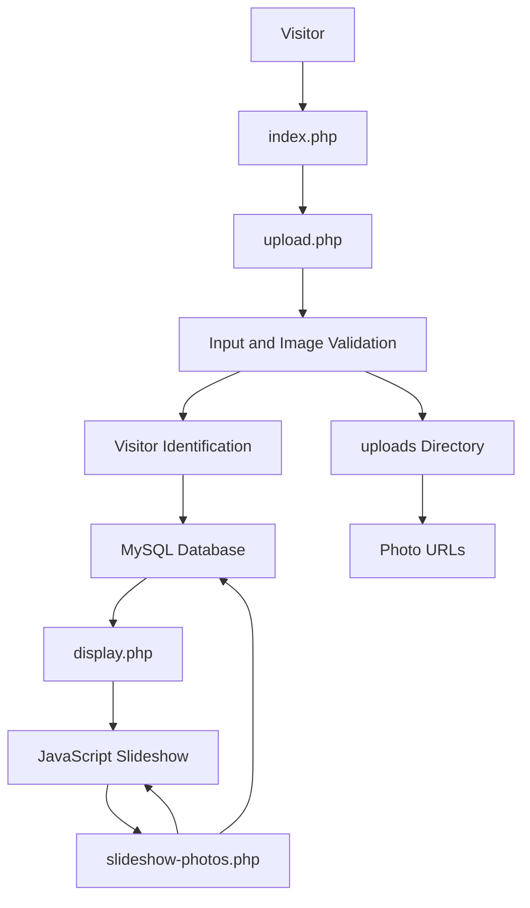

# Architecture – Visitor Photo Slideshow

## 1. Overview

The Visitor Photo Slideshow application uses a simple three-layer architecture consisting of the presentation layer, application layer and data storage layer.

The application is developed using Core PHP, HTML, CSS, JavaScript and MySQL.

## 2. System Architecture

### Presentation Layer
Technologies: HTML, CSS and JavaScript.

Responsibilities:
- Display the visitor registration and photo upload form.
- Collect visitor information and consent.
- Show photo previews.
- Display the shared photo slideshow.
- Provide Pause and Play controls.

### Application Layer
Technology: Core PHP 8+.

Responsibilities:
- Validate visitor information.
- Validate uploaded image files.
- Identify new and returning visitors.
- Store uploaded photographs.
- Insert and retrieve database records.
- Provide slideshow photo data through a PHP API.

### Data Storage Layer

Technologies: MySQL and the server's uploads directory.

Responsibilities:
- Store visitor information in MySQL.
- Store photo metadata in MySQL.
- Store actual photograph files in the uploads directory.

## 3. System Workflow

1. Visitor opens `index.php`.
2. Visitor enters their name and email address.
3. Visitor selects 1–5 photographs.
4. Visitor provides consent for public slideshow display.
5. Form submits to `upload.php`.
6. PHP validates all submitted information and photographs.
7. PHP identifies the visitor using their email address.
8. Valid photographs are moved to the `uploads` directory.
9. Visitor and photo records are inserted or updated in MySQL.
10. After successful submission, the browser redirects to `display.php`.
11. JavaScript retrieves photographs through `api/slideshow-photos.php`.
12. The shared slideshow displays the photographs.

## 4. Architecture Diagram



## 5. Database Design

The application uses two MySQL tables.

### visitors

| Column | Description |
|---|---|
| visitor_id | Primary key, auto increment |
| name | Visitor name |
| email | Unique email address |
| created_at | Visitor registration timestamp |
| updated_at | Last profile update timestamp |

### photos

| Column | Description |
|---|---|
| photo_id | Primary key, auto increment |
| visitor_id | Foreign key referencing visitors |
| stored_filename | Unique stored photograph filename |
| mime_type | Actual image MIME type |
| file_size_bytes | Photograph size in bytes |
| consent_given | Visitor consent record |
| consent_at | Consent timestamp |
| uploaded_at | Photograph upload timestamp |

### Relationship

One visitor can upload multiple photographs.

Relationship: `visitors (1) -> photos (Many)`

The `visitor_id` column in the photos table references `visitor_id` in the visitors table.

The foreign key uses `ON DELETE CASCADE`.

## 6. Photo Storage

Actual image files are stored in:

```text
uploads/
```

MySQL stores the photograph filename and metadata, not the image binary data.

Unique random filenames are generated for uploaded photographs.

## 7. Slideshow Design

The shared slideshow is available through `display.php`.

The JavaScript file `assets/js/slideshow.js` controls the display.

- Slide duration: 2 seconds.
- New-photo refresh interval: 5 seconds.
- Pause and Play controls are available.
- The complete photograph is displayed without cropping.
- Newly uploaded photographs are added to the shared slideshow automatically.

## 8. Important Technology Decisions

| Decision | Reason |
|---|---|
| Core PHP | Simple backend suitable for the assignment |
| MySQL | Stores visitor and photograph information |
| PDO | Secure database interaction |
| HTML, CSS and JavaScript | Simple frontend implementation |
| Separate uploads directory | Keeps image files separate from database records |
| Email identification | Identifies returning visitors |
| Shared slideshow | Displays photographs from all visitors |

## 9. Security Considerations

- Server-side validation of uploaded files.
- MIME type and image-content verification.
- Maximum file size of 5 MB per photograph.
- Maximum 5 photographs per submission.
- Unique random filenames.
- PDO prepared statements.
- Database transaction for related database changes.
- Visitor consent recorded for submitted photographs.
- Apache directory listing disabled.
- Direct access to configuration and environment files restricted.
- PHP execution blocked in the uploads directory.

## 10. Project Scope

This architecture is intentionally simple and designed for a short academic practical assignment.

It does not include an administrator dashboard, automatic photo deletion, cloud storage, external APIs or additional application frameworks.