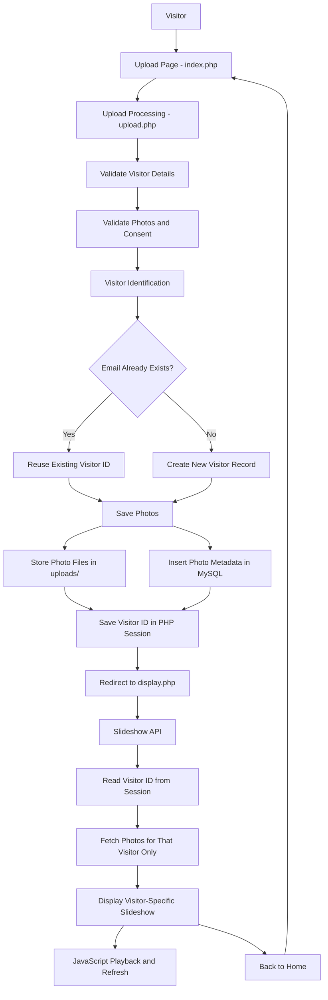
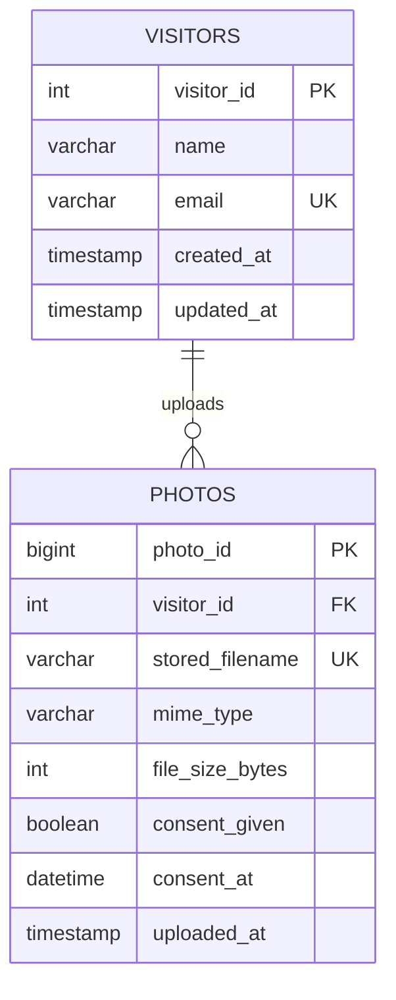

# System Architecture – Visitor Photo Slideshow

## 1. Introduction

The Visitor Photo Slideshow is a simple web application developed using Core PHP, HTML, CSS, JavaScript and MySQL.

The system allows visitors to submit their names, email addresses and photographs. Uploaded photographs are stored on the server, while visitor details and photograph metadata are stored in MySQL.

Each visitor is shown only their own photographs in the slideshow. The application uses PHP sessions to maintain the visitor ID after a successful upload.

The system does not include user accounts, passwords, login or logout functionality.

## 2. Technology Architecture

| Layer | Technology | Responsibility |
|---|---|---|
| Presentation | HTML, CSS | Upload form and slideshow interface |
| Client-side logic | JavaScript | Image previews, slideshow playback and periodic refresh |
| Application | Core PHP 8+ | Form processing, validation, sessions and API responses |
| Database access | PHP PDO | Secure communication with MySQL |
| Database | MySQL | Visitor information and photo metadata |
| File storage | Local uploads directory | Stores actual photograph files |
| Development environment | XAMPP | Local Apache and MySQL services |
| Version control | Git and GitHub | Source code management |

## 3. High-Level Architecture

The application consists of the following main components:

1. Visitor Upload Interface
2. Upload Processing Module
3. Visitor Identification Module
4. PHP Session Management
5. MySQL Database
6. Photo File Storage
7. Visitor-Specific Slideshow
8. Slideshow API

## 4. System Architecture Diagram



## 5. Application Modules

### 5.1 Visitor Upload Module

File: `index.php`

Responsibilities:

- Display the visitor upload form.
- Collect visitor name and email address.
- Allow selection of photographs.
- Display selected image previews.
- Collect visitor consent.
- Submit the form to `upload.php`.

### 5.2 Upload Processing Module

File: `upload.php`

Responsibilities:

- Accept POST requests.
- Validate visitor name and email.
- Check visitor consent.
- Validate the number and size of photographs.
- Validate actual image MIME types and image content.
- Generate unique filenames.
- Move valid photographs into the uploads directory.
- Connect to MySQL using PDO.
- Create a new visitor record or reuse an existing visitor record.
- Insert photo metadata associated with the visitor ID.
- Use a database transaction for database changes.
- Store the visitor ID in the PHP session after a successful upload.
- Redirect the visitor to the slideshow page.

### 5.3 Visitor Identification Module

The application identifies visitors using their email address.

The `visitors` table has a unique constraint on the email column.

When a visitor submits the form:

- If the email address is new, a visitor record is created.
- If the email address already exists, the existing visitor record is reused.
- The corresponding `visitor_id` is obtained from the database.

The visitor ID is then stored in the PHP session.

### 5.4 Session Management Module

PHP sessions maintain the visitor ID between the successful upload and slideshow requests.

After saving the uploaded photographs:

```php
session_regenerate_id(true);

$_SESSION['visitor_id'] = $visitorId;
```

The slideshow page and slideshow API check this session value before allowing access.

The visitor ID is not accepted from a URL parameter or JavaScript request.

If the visitor session is missing, the slideshow page redirects to the upload page, and the API returns an unauthorized response.

**Session identification is not account authentication.** The application does not verify ownership of an email address and does not implement passwords or login/logout.

### 5.5 Slideshow Display Module

File: `display.php`

Responsibilities:

- Start the PHP session.
- Verify that a visitor ID exists in the session.
- Redirect visitors without a valid session to `index.php`.
- Display the slideshow interface.
- Show the upload success message when available.
- Provide Pause and Play controls.
- Provide a Back to Home link.
- Load the slideshow JavaScript.

### 5.6 Slideshow API Module

File: `api/slideshow-photos.php`

Responsibilities:

- Start the PHP session.
- Check the current visitor ID.
- Connect to MySQL.
- Fetch only photographs associated with that visitor.
- Return photograph IDs and image URLs in JSON format.
- Avoid returning visitor email addresses or names.
- Return an error response when the visitor session is unavailable or retrieval fails.

The database query uses a prepared statement:

```sql
SELECT
    photo_id,
    stored_filename,
    uploaded_at
FROM photos
WHERE visitor_id = :visitor_id
ORDER BY photo_id ASC
```

The `visitor_id` value comes from the server-side PHP session.

This ensures the API returns only the current visitor's photographs.

### 5.7 Slideshow JavaScript Module

File: `assets/js/slideshow.js`

Responsibilities:

- Request the visitor's photographs from the slideshow API.
- Display one photograph at a time.
- Automatically change photographs every 2 seconds.
- Check for new photographs every 5 seconds.
- Maintain the current photograph when new photographs are detected.
- Provide Pause and Play functionality.
- Update the photo counter.
- Handle empty slideshow results and API errors.

### 5.8 Photo Storage Module

Directory: `uploads/`

Responsibilities:

- Store actual uploaded photograph files.
- Use randomly generated filenames.
- Keep uploaded image files separate from database records.
- Prevent directory listing.
- Block PHP-like file execution through the directory's `.htaccess` configuration.

The database stores filenames and metadata, not the actual image binary data.

## 6. Database Architecture

The application uses two relational tables.

### 6.1 visitors Table

Stores visitor information.

| Field | Data type | Description |
|---|---|---|
| visitor_id | INT UNSIGNED | Primary key |
| name | VARCHAR(100) | Visitor name |
| email | VARCHAR(254) | Unique visitor email |
| created_at | TIMESTAMP | Record creation time |
| updated_at | TIMESTAMP | Last update time |

### 6.2 photos Table

Stores photograph metadata.

| Field | Data type | Description |
|---|---|---|
| photo_id | BIGINT UNSIGNED | Primary key |
| visitor_id | INT UNSIGNED | Foreign key referencing visitors |
| stored_filename | VARCHAR(100) | Unique stored filename |
| mime_type | VARCHAR(40) | Image MIME type |
| file_size_bytes | INT UNSIGNED | Image file size |
| consent_given | TINYINT(1) | Consent status |
| consent_at | DATETIME | Consent timestamp |
| uploaded_at | TIMESTAMP | Upload timestamp |

### 6.3 Relationship Diagram



One visitor can upload multiple photographs.

Each photograph belongs to one visitor through the `visitor_id` foreign key.

The foreign key uses `ON DELETE CASCADE`, so deleting a visitor record also deletes its associated photo metadata. The corresponding physical files would still require manual removal.

## 7. Visitor-Specific Slideshow Workflow

The visitor-specific workflow is:

1. A visitor submits the upload form.
2. The application validates the visitor details and photographs.
3. The application identifies the visitor using the email address.
4. The visitor ID is obtained from MySQL.
5. The uploaded photographs are saved and associated with that visitor ID.
6. The visitor ID is stored in the PHP session.
7. The visitor is redirected to `display.php`.
8. The slideshow API reads the visitor ID from the session.
9. The API retrieves only photographs associated with that visitor ID.
10. JavaScript displays those photographs in the slideshow.

### Example

Suppose three visitors upload photographs:

| Visitor | Visitor ID | Uploaded photographs |
|---|---:|---:|
| Visitor A | 1 | A1, A2 |
| Visitor B | 2 | B1, B2, B3 |
| Visitor C | 3 | C1 |

The slideshow results are:

| Current visitor session | Photographs displayed |
|---|---|
| Visitor A | A1, A2 |
| Visitor B | B1, B2, B3 |
| Visitor C | C1 |

Photographs belonging to other visitor IDs are not included in the API response.

## 8. File and Folder Responsibilities

| File or directory | Responsibility |
|---|---|
| `index.php` | Visitor upload form |
| `upload.php` | Upload processing and visitor identification |
| `display.php` | Visitor-specific slideshow page |
| `config/env.php` | Reads environment configuration |
| `config/database.php` | Creates PDO database connection |
| `api/slideshow-photos.php` | Retrieves current visitor's photographs |
| `assets/css/style.css` | Application styling |
| `assets/js/upload.js` | Client-side upload validation and previews |
| `assets/js/slideshow.js` | Slideshow playback and refresh |
| `uploads/` | Stores uploaded photographs |
| `database/schema.sql` | Database and table creation |
| `tests/` | Manual testing documentation |

## 9. Security and Validation Design

The application uses basic security practices suitable for this practical assignment.

### Input Validation

- Validate visitor names and email addresses on the server.
- Require photo display consent.
- Restrict the number of photographs per submission.
- Restrict each photograph to a maximum of 5 MB.

### File Validation

- Allow only JPG, JPEG, PNG and WebP.
- Validate the actual MIME type using PHP Fileinfo.
- Verify image content using `getimagesize()`.
- Generate random filenames.
- Use `move_uploaded_file()` to store uploaded files.

### Database Security

- Use PDO for database access.
- Use prepared statements for SQL operations.
- Use database transactions for inserting visitor and photo records.

### Session and Slideshow Protection

- Store the visitor ID in a server-side PHP session.
- Check the session in `display.php`.
- Check the session in the slideshow API.
- Use the session visitor ID in the SQL filter.
- Do not accept a visitor ID from the browser.
- Do not expose visitor email addresses through the slideshow API.

### Directory Protection

- Disable directory listing.
- Protect the `.env` file.
- Restrict direct access to configuration and database files.
- Block PHP-like file execution in the uploads directory.

## 10. Limitations and Design Decisions

- The application is intended for a short college practical assignment.
- It does not implement full user authentication.
- There are no passwords, login or logout features.
- A visitor is identified through an email address submitted in the upload form.
- PHP sessions maintain the visitor ID for the current browser session.
- There is no administrator dashboard.
- There is no automatic photo deletion.
- Stored photographs remain until manually removed by an administrator.
- The project uses local XAMPP storage and is not designed as a production hosting system.

## 11. Conclusion

The architecture combines Core PHP, MySQL, PHP sessions, JavaScript and local file storage to provide a simple visitor photo-upload and slideshow application.

The system maintains a relationship between visitors and their photographs through the database. Server-side session identification and visitor-specific SQL filtering ensure that each slideshow displays only the photographs associated with the current visitor ID.